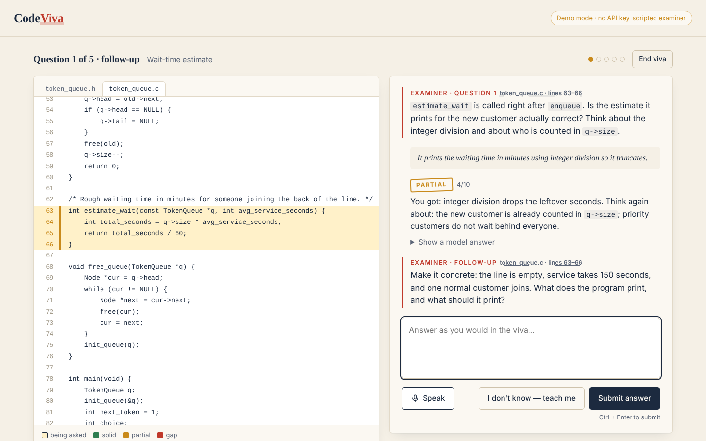
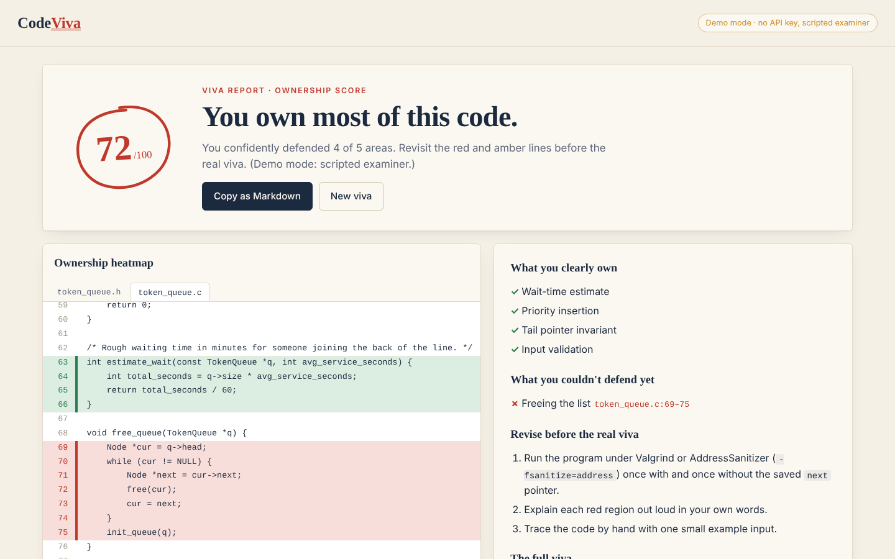
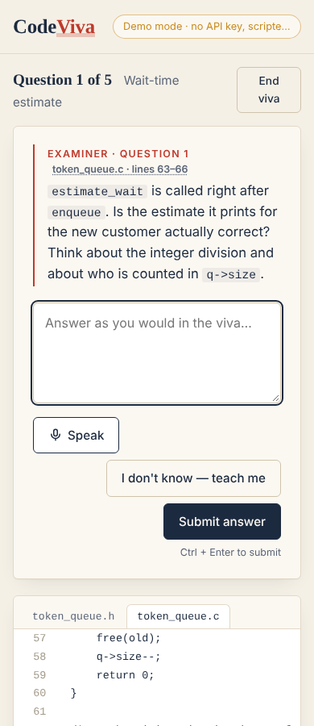
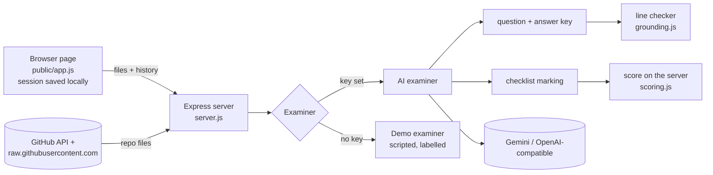

# CodeViva

**A mock viva for the code you shipped. CodeViva questions you about the exact lines of your own project, marks each answer against an answer key written before you answer, and lets you re-test what you couldn't defend — so you find your gaps before a real examiner, reviewer or interviewer does.**

Built for the [Global AI Builder's Challenge 2026](https://global-ai-builders-challenge.devpost.com/), as a substantial upgrade of the version made for *Build With AI: Basics* (tag [`basics-baseline`](../../tree/basics-baseline)). What changed during the event: [`docs/HACKATHON-CHANGES.md`](docs/HACKATHON-CHANGES.md).



## The problem

Sooner or later someone points at your code and asks *"why is this here?"* or *"what happens if the list is empty?"* — an examiner in a project viva, a TA at a demo, an interviewer saying *"walk me through your project"*.

More and more of that code is written with AI assistants. It works, but the person who shipped it often can't explain it, and universities are bringing back oral exams for exactly that reason. Re-reading your code the night before doesn't show you what you *can't* explain; asking a chatbot to "quiz me" gives questions that are not tied to your lines and grades that change every time.

## What CodeViva does

1. **Load your project** — paste a public **GitHub link** (source files are preselected within the size budget), drop files in, paste a snippet, or try the bundled C sample.
2. **The examiner asks about specific lines**, highlighted in the code panel. A **line checker** verifies that each question really is about the highlighted lines and fixes or re-asks it if not (*✓ lines checked*).
3. **Answer by typing or speaking** — in English or in your own language (10 languages, including Bangla), or press *I don't know — teach me*.
4. **Every answer is marked against an answer key** — 2–4 key points the examiner wrote *before* you answered. You see which points you covered (✓), half-covered (½) or missed (✗), and any technically wrong claim. The **score is computed from that checklist on the server**, not picked by the model. Shallow answers get one pointed follow-up.
5. **The report** gives an ownership score and an **ownership heatmap** — your code with each examined region coloured by how well you defended it — plus three concrete things to revise.
6. **Re-test my gaps** asks new questions about only the lines you couldn't defend, then shows **before → after** for each one.

A refresh or a closed tab loses nothing: the viva is saved in your browser and can be resumed.

| Report with ownership heatmap | Phone width |
|---|---|
|  |  |

## Quick start

Requires **Node.js 18.17+**.

```bash
npm install
cp .env.example .env        # Windows: copy .env.example .env
# put your free Gemini key in .env  (https://aistudio.google.com/apikey)
npm start
```

Open **http://localhost:3000**.

**No key?** It still runs in a clearly labelled **demo mode**: a scripted examiner (no AI), fully scripted for the bundled sample and pattern-based for other code. For real questions about your own code, add a key.

### Configuration (`.env`)

| Variable | Purpose |
|---|---|
| `GEMINI_API_KEY` | Google Gemini key (default provider, free tier) |
| `GEMINI_MODEL` | Optional. Default `gemini-3.1-flash-lite`. |
| `AI_PROVIDER=openai` + `OPENAI_API_KEY`, `OPENAI_BASE_URL`, `OPENAI_MODEL` | Any OpenAI-compatible API (OpenAI, Groq, OpenRouter, a local server) |
| `GITHUB_TOKEN` | Optional. Raises GitHub's limit for loading repos by link (60 → 5,000 per hour). No scopes needed. |
| `DEMO_MODE=1` | Force the scripted demo examiner |
| `PORT` | Default `3000` |

## How it works



- **Questions** — the code is sent with a number on every line; the model returns `{file, startLine, endLine, question, keyPoints}`.
- **Line checker** (`src/grounding.js`) — the file and lines must exist, identifiers named in `backticks` must appear in the highlighted lines, "line N" in the text must be inside the highlight, and an already-examined region is not asked again. A wrong highlight is moved to where the identifiers really are (anchored on the most specific one, preferring the named file); otherwise the model is asked once more and told what was wrong.
- **Answer-key grading** — the grader only marks each key point *covered / partial / missing* and lists wrong claims. `src/scoring.js` turns that into the score: covered 1, partial ½, missing 0, ×10, minus 3 per wrong claim. Same marks → same score.
- **Ownership score** — the average of the questions, where a question counts the better of the answer and its follow-up.
- **Nothing the model says is inserted as HTML** (`textContent` only). The server is stateless; the session lives in the browser. Your code goes only to the configured AI provider (and, for a GitHub link, is read from GitHub).

```
codeviva/
├── server.js                    # Express app: viva routes + GitHub routes
├── src/
│   ├── config.js                # Gemini / OpenAI-compatible / demo, chosen from .env
│   ├── code.js                  # validate files, number lines, clamp ranges
│   ├── grounding.js             # line checker for AI questions
│   ├── prompts.js               # examiner instructions, answer key, checklist marking, re-test
│   ├── scoring.js               # checklist score and ownership score
│   ├── github.js                # list a public repo, fetch chosen files
│   ├── llm/                     # Gemini + OpenAI-compatible clients, tolerant JSON parsing
│   └── examiners/               # AI examiner (validated) and demo examiner (scripted)
├── public/                      # index.html, styles.css, app.js, samples/
├── eval/                        # evaluation set, human labels, results
├── scripts/                     # npm run label / npm run eval
├── test/                        # node:test suites
└── docs/                        # what changed during the event, AI use, screenshots
```

## Evaluation

`eval/` holds 30 answers to 5 viva questions on real student code (C, Python and Java, from the bundled sample and two of the author's course projects), in English, Bangla and Banglish, each labelled by a human. `npm run eval` grades every answer several times with the **answer-key grader** and the **old holistic grader** (the model picks a 0–10 score), compares both with the human labels, and counts how often the line checker had to repair or re-ask questions. Results: [`eval/results/SUMMARY.md`](eval/results/SUMMARY.md) · method: [`eval/README.md`](eval/README.md).

## Tests

```bash
npm test
```

64 tests with Node's built-in runner: line numbering and ranges, the line checker, checklist scoring, the AI examiner against a fake model with deliberately messy replies, re-tests, GitHub loading against a fake GitHub, the Gemini/OpenAI clients against a mocked `fetch`, the evaluation's arithmetic, and full vivas through the HTTP API.

## Limitations

- The line checker can only verify questions that name an identifier in `backticks` or mention a line number; a question with neither is accepted on the model's word (shown as *✓ lines checked* only when nothing contradicts it).
- Grading quality depends on the model and on the answer key it writes; see the evaluation for where it agrees and disagrees with a human.
- Up to 60,000 characters and 20 files per viva — pick the files your viva covers. GitHub loading works for public repositories only.
- Voice answers use the browser's speech recognition (best in Chrome/Edge); the mic button is hidden where unsupported. Recognition quality for some languages varies by browser.
- Demo mode (no key) is a script, not AI, is English only, and is labelled everywhere it appears.
- In self-practice a student could paste the question into another chatbot; CodeViva is a practice tool, not a proctoring tool.

## AI use

How AI is used inside the product and how AI was used to build it during the event, and how that work was checked: [`docs/AI-USE.md`](docs/AI-USE.md).

## License

[MIT](LICENSE)
