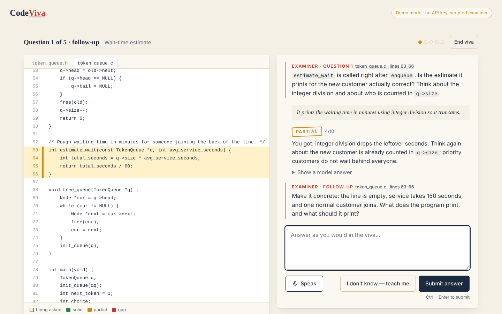
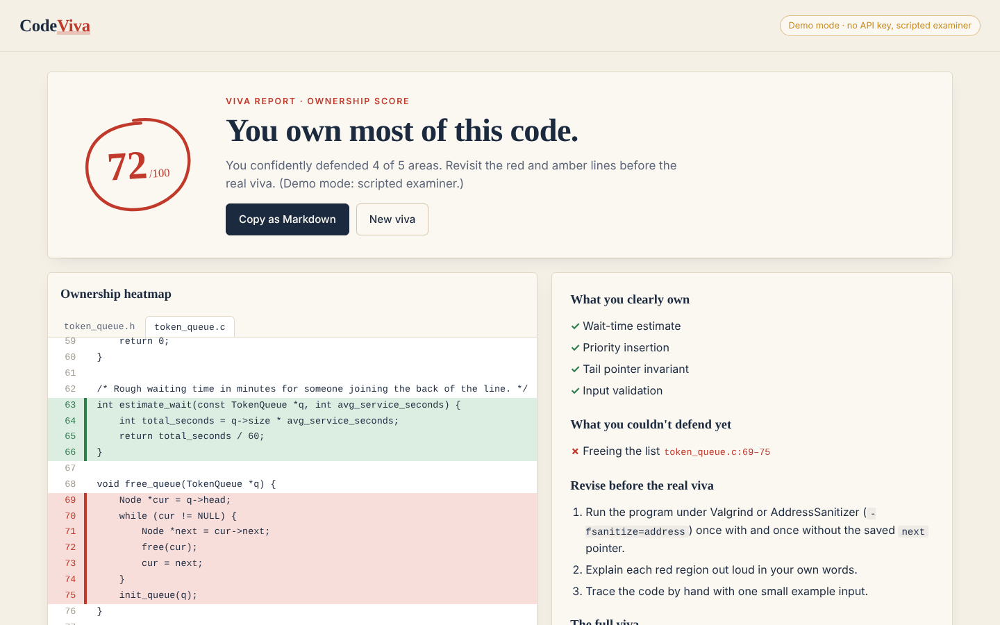
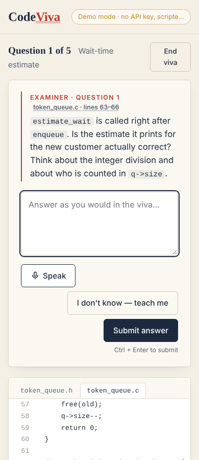
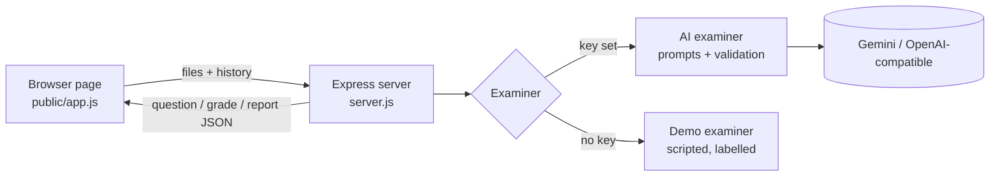

# CodeViva

**An AI viva examiner that questions you about the exact lines of code you shipped — so you find out what you can't defend before a real examiner does.**

Built for the Devpost [Build With AI: Basics](https://learn-ai-basics.devpost.com/) hackathon, planned and built with the [Devpost Learn Skill Pack](https://github.com/challengepost/learn-ai-basics).



## The problem

Sooner or later, someone points at your code and asks *"why is this here?"* or *"what happens if the list is empty?"* — an examiner in a project **viva** or defense, a TA at a demo, a senior engineer in a code review, an interviewer saying *"walk me through your project"*.

More and more of that code is written with AI coding agents. It works, but the person who shipped it often can't explain it. Re-reading your code the night before doesn't tell you what you *can't* explain, and a friend quizzing you doesn't know your code.

## What CodeViva does

1. **Load your project** — drag in files, paste a snippet, or try the bundled sample (a C bank-token queue, a classic data-structures assignment).
2. **The examiner asks about specific lines** — the code panel jumps to and highlights them. Questions target what real examiners ask: edge cases, design choices, memory handling, complexity.
3. **Answer by typing or speaking** — or press *I don't know — teach me*.
4. **Every answer is marked** *Solid / Partial / Gap* with feedback and a model answer. **Shallow answers get one pointed follow-up**, like an examiner pushing back.
5. **The report** gives an ownership score out of 100 and an **ownership heatmap**: your code with each examined region coloured by how well you defended it, plus three concrete things to revise.

The examiner can be a *Friendly TA* or a *Strict external*. It speaks English by default; **non-native English speakers can choose to be examined in their own language** (10 languages, AI mode), so they're judged on understanding, not fluency.

| Report with ownership heatmap | Phone width |
|---|---|
|  |  |

## Quick start

Requires **Node.js 18.17+**.

```bash
npm install
cp .env.example .env        # Windows: copy .env.example .env
# put your free Gemini key in .env  (https://aistudio.google.com/apikey)
npm start
```

Open **http://localhost:3000**.

**No key?** It still runs, in **Demo mode**: a scripted examiner (no AI), clearly labelled, fully scripted for the sample project and pattern-based for other code. It's there so anyone can see the full journey; for real questions about your own code, add a key.

### Configuration (`.env`)

| Variable | Purpose |
|---|---|
| `GEMINI_API_KEY` | Google Gemini key (default provider, free tier) |
| `GEMINI_MODEL` | Optional. Default `gemini-3.1-flash-lite`. Set another current model if Google renames it. |
| `AI_PROVIDER=openai` + `OPENAI_API_KEY`, `OPENAI_BASE_URL`, `OPENAI_MODEL` | Any OpenAI-compatible API (OpenAI, Groq, OpenRouter, local server) |
| `DEMO_MODE=1` | Force the scripted demo examiner |
| `PORT` | Default `3000` |

### Tests

```bash
npm test
```

29 tests with Node's built-in runner: line numbering and range repair, scoring, the demo examiner, the AI examiner against a fake model with deliberately messy replies, the Gemini/OpenAI clients against a mocked `fetch`, and a full viva through the HTTP API.

## How it works



- The code is sent to the model **with a line number in front of every line**, and the model must reply with a fixed JSON shape: `{file, startLine, endLine, topic, question}`.
- **Nothing the model says is trusted blindly.** `src/code.js > clampRange` snaps file names and line numbers back onto real code; the **score decides the verdict** so stamps, heatmap and total always agree; follow-ups are limited to one per question.
- The **ownership score is computed on the server** (`src/scoring.js`), not by the AI: average of the questions, where a question counts the better of the original answer and its follow-up — recovering under questioning is rewarded.
- The server is **stateless**; the session lives in the browser tab. Nothing is stored. Your code goes only to the configured AI provider.
- All model text is inserted into the page with `textContent`, never `innerHTML`.

```
codeviva/
├── server.js                    # Express app + 4 JSON routes
├── src/
│   ├── config.js                # Gemini / OpenAI-compatible / demo, chosen from .env
│   ├── code.js                  # validate files, number lines, clamp line ranges
│   ├── prompts.js               # the examiner's instructions and JSON shapes
│   ├── scoring.js               # deterministic ownership score
│   ├── llm/                     # Gemini + OpenAI-compatible clients, tolerant JSON parsing
│   └── examiners/               # AI examiner (validated) and demo examiner (scripted)
├── public/                      # index.html, styles.css, app.js, samples/
├── test/                        # node:test suites
└── devpost/                     # Skill Pack planning docs + app map
```

## Built with the Devpost Learn Skill Pack

The project followed the pack's six skills, and the planning documents are in the repo:

| Step | Document |
|---|---|
| `2-scope` — the kernel, the user, the PoC boundary | [`devpost/scope.md`](devpost/scope.md) |
| `3-prd` — journey, behaviours, states, acceptance criteria | [`devpost/prd.md`](devpost/prd.md) |
| `4-spec` — architecture, data flow, failure modes | [`devpost/spec.md`](devpost/spec.md) |
| `5-build` — verified, committed slices and revisions | [`devpost/checklist.md`](devpost/checklist.md) |
| `5-build` — app map of the finished code | [`devpost/app-map.html`](devpost/app-map.html) |

The skills themselves are installed in `.agents/skills/` (with a copy in `.claude/skills/` for Claude Code), pinned in `skills-lock.json`. Each planning document starts with a process note about how it was produced.

## Limitations

- Demo mode (no key) is English only; other examiner languages need the AI examiner.
- Voice answers use the browser's speech recognition (best in Chrome/Edge); the mic button is hidden where unsupported.
- Up to 60,000 characters of code per viva — load the files your viva covers, not the whole repo.
- Small free-tier models can occasionally pick a slightly off line range; the server clamps it to real lines, and you can always click the line reference to jump.
- Demo mode is a script, not AI — it is labelled everywhere it appears.

## Roadmap

Load a GitHub repo by URL · a spoken examiner (text-to-speech) for a full mock viva · "explain this commit" mode for code your AI agent just changed · a teacher mode that generates a viva for a student's submission.

## License

[MIT](LICENSE)
